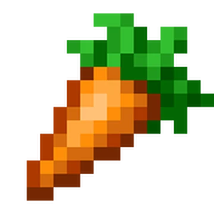
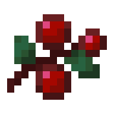
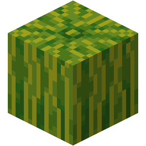
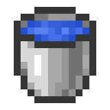

The theme this week was outside, so I made a gardin

CONTROLS:
    -You can click the crops (carrots, berries, and melons), the tools (waterbucket and hoe)
    -Use the waterbucket to water the garden on the left
    -Click a crop and then click the plot you just watered, this plants the crop
    -Wait for the crop to grow, and then select the hoe and then click the grown crop to harvest it
    -Then you can sell your crops to the market, or buy more if you have the gold for it. 
GOAL:
    -Make as much gold as you want 

I just wanted to make a garden similar to Terra, and thought it is pretty good especially because of the CSS stuff.

---------------------------------
<!DOCTYPE html>
<html lang="en">
<head>
  <meta charset="UTF-8">
  <meta name="viewport" content="width=device-width, initial-scale=1.0">
  <title>Garden</title>
  <link rel="stylesheet" href="style.css">
</head>

<body>

<h1 id="garden-title">My Little Garden</h1>

 

    
    <!--LEFT SIDE OF THE SCREEN (PLOTS)-->
    

        <!--FARMING PLOTS-->
        
 

        
 

        
 

        
 

        
gardens 

        
 

        
 

        
 

        
 

    

    <!--RIGHG SIDE OF SCREEN (SELL, CROPS, TOOLS)-->
    

         <!--Market box-->
        

            

                <button id="mode-toggle-btn">Switch to Buy</button>
                
Gold: 0

            

            

                <select id="market-crop-select">
                    <option value="carrot">Carrot</option>
                    <option value="berry">Berry</option>
                    <option value="melon">Melon</option>
                </select>
                <input type="number" id="market-amount" value="1" min="1" style="width: 50px;">
                <button id="market-action-btn">Sell</button>
            

        

        <!--CROPS AND TOOLS BUTTONS-->
        

            

                <button class="tool-btn" id="carrot-button" ></button>
                1
            

            

                <button class="tool-btn" id="berry-button" ></button>
                0
            

            

                <button class="tool-btn" id="watermelon-button"></button>
                0
            

        

    
        <!--TOOLS BUTTONS-->
        

            <button class="tool-btn" id="diamond-hoe-button" ></button>
            <button class="tool-btn" id="water-button" ></button>
        

    

</body>
</html>
